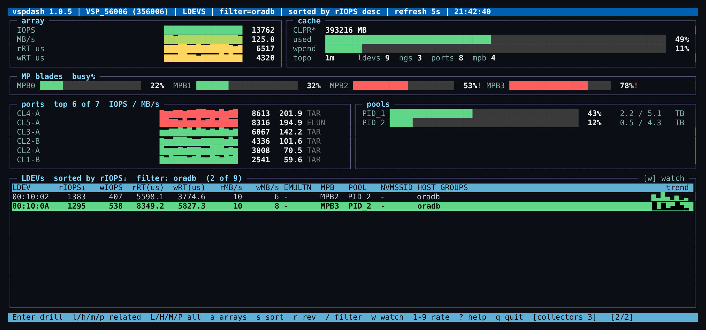

# Introduction

**vsptop6** shows what a Hitachi VSP array is doing *right now*, the way `top` shows a Linux
host: a full-screen terminal view that refreshes every 5 seconds (configurable from 5 s to
60 s), sortable and filterable by any column, with the objects that matter correlated to each
other so you can move from a busy host group to its LDEVs, from an LDEV to its MP blade, from a
port to the host groups on it — all with single keystrokes.

It is the C/ncurses successor of the original Perl `vsptop` (2014–2015) and keeps its
operating model: a small set of collector programs read performance counters straight from the
array through the RAID Manager Library, and an hourly job records how everything is wired
together using `raidcom`.

## Supported arrays

Any array reachable through Hitachi Command Control Interface with the RAID Manager Library:
VSP One Block (B2x/B8x), VSP 5000, VSP E/F/G series. Fibre Channel, iSCSI and NVMe/TCP front
ends are all represented; mainframe (FICON, 3390-x) volumes appear with their emulation.

## The screens

```
ARRAYS ──Enter──► LDEVS ──h──► HOST GROUPS ──p──► PORTS ──l──► LDEVS
                    │ m            │ l               │ h
                    ▼              ▼                 ▼
                  MPBS ──l──► LDEVS            HOST GROUPS
```

| Screen | Columns |
|---|---|
| **Arrays** | serial, name, #LDEVs, #host groups, #ports, cache used %, write-pending %, total IOPS and MB/s, age of the topology data |
| **LDEVs** | read/write IOPS, read/write response time (µs), read/write MB/s, RND% (random share of I/O), rHIT% / wHIT% (read / write cache-hit ratios), emulation, MP blade, pool, attributes (`VOL_ATTR` minus the constant `CVS`: HDP, JNL, POOL, GAD, ELUN …), NVMe subsystem id, SSID (mainframe), virtual LDEV id (GAD / VSM volumes), resource group (`RSGID` resolved to its `RS_GROUP` name) |
| **Host groups** | host mode, type (FIBRE for WWN groups, iSCSI for IQN groups), #LDEVs, read/write IOPS, max response time, read/write MB/s, RND%, rHIT% (IOPS-weighted over the group's LDEVs), ports, pools |
| **MP blades** | per MP: busy %, cache usage, write pending, role, owning resource, the owning LDEV's attributes, #LDEVs |
| **Ports** | type (FIBRE/ISCSI/NVME_TCP/FICON), attributes (TAR/MCU/RCU/ELUN), link speed (Gbps, from `raidcom get port -key opt`), IOPS, MB/s, read/write IOPS, read/write response time (µs), read/write MB/s, #LDEVs, NVMe subsystem ids |

Every screen has a three-line header: the title (array, screen, scope, sort column, refresh
rate), a **Cache Summary** (capacity, usage and write-pending in MB and %) and a **Storage
Summary** (array-wide total/read/write IOPS and MB/s).

Rows past a threshold you set — response time (LDEVs, host groups, ports), MP busy %, port link
utilisation — are amber at the warning level and red at the problem level so they stand out at a glance (amber/green/underline are available via `highlight=`). Cache usage is shown without a warning colour — a Hitachi array keeps its cache full by design; write-pending is the figure to watch.

## Two front ends

The RPM installs two programs that share everything but the screen layout:

- **`vsptop`** — the classic `top`-like table above: one screen at a time, three header lines.
- **`vspdash`** — a btop-style dashboard. The current array's IOPS, MB/s and response-time
  history, cache and pool capacity meters, MP-blade busy meters and per-port sparklines sit in
  panels above the same table, which gains a **trend** column graphing the sort column over the
  last eight samples. All keys are identical; drilling, sorting, filtering and `w` watch change
  the table panel while the panels above keep following the current array.



## How it works

```
 vsptop.conf ──► genarrayhash ──► raidcom get ldev / port / pool ──► topology.db (SQLite)
                                    (hourly, via cron)                      │
                                                                            ▼
 vsptop.conf ──► vsptop ◄── keyboard                                 correlations
                   │
                   │ one process per data source, re-sampled every refresh
                   ▼
   allldevstat   allportstat   allmpinfo   cachestat        (RAID Manager Library)
```

- **`genarrayhash`** asks `raidcom` for every LDEV (emulation, attributes, MP, pool, SSID,
  virtual id, resource group), host group (members, host mode), port (type, attributes), pool
  (members, capacity), resource group and NVMe subsystem, and stores the relationships in a
  small SQLite file. It runs hourly; the arrays screen shows how old the data is.
- **`vsptop`** starts the collectors it needs for the current screen, reads their output, joins
  it with the topology, and draws the table. Collectors are small C programs that talk to the
  array through the RAID Manager Library over a command device; they never write to the array.

## What it is not

vsptop6 is a live viewer, not a historian: it keeps no history and draws no graphs. For
long-term trending use Ops Center Analyzer / VSP 360. It also makes no configuration changes
of any kind — the array account it uses only needs a view-only role.
