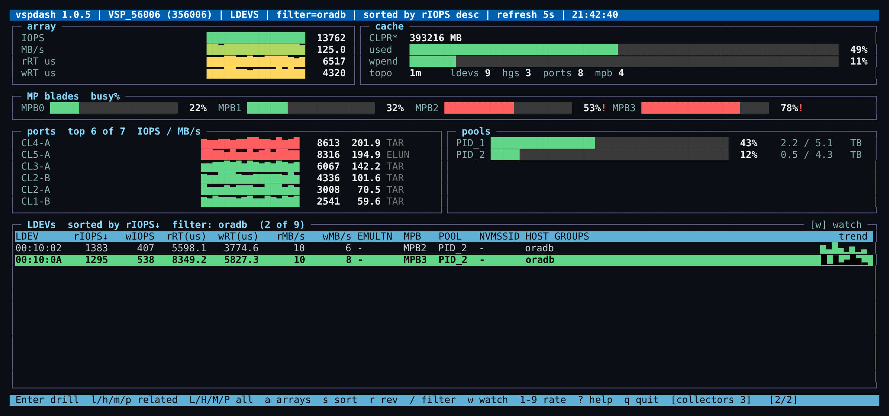

# README — quick start and key reference

## Quick start

```sh
# 1. prerequisite on the host: the Hitachi RAID Manager Library (/usr/lib64/libsvrrm.so)
#    (CCI / raidcom is optional: full-length host-group names and NVMe subsystem ids)
# 2. install
dnf install https://github.com/visubramaniam/vsptop6-releases/releases/download/v4.0.3/vsptop6-4.0.3-1.el9.x86_64.rpm
# 3. configure: arrays, array user/password (see Configure for password rules), command devices
vi /usr/local/san/vsp/conf/vsptop.conf
vsptop -P              # optional: encrypt the passwords you just typed (pass=enc:...)
# 4. run: the first start builds the topology from RMLIB (vsptop -T -v does it by hand and shows each step)
vsptop                 # top-like table
vspdash                # the same monitor as a btop-style dashboard
```

## What gets installed

```
/usr/local/san/vsp/bin/     vsptop, vspdash, the collectors (allldevstat, allportstat, allmpinfo, cachestat, loginstat, topostat)
/usr/local/san/vsp/conf/.key  created by vsptop -P: the host-bound key for pass=enc: (mode 0400)
/usr/local/san/vsp/conf/    vsptop.conf, vsptop.conf.example
/usr/local/san/vsp/var/     topology.db (built and refreshed by vsptop itself)
/usr/local/san/vsp/doc/     this documentation
/usr/bin/vsptop, /usr/bin/vspdash   (symlinks)
```

## vspdash — the dashboard view

`vspdash` is the same monitor as a btop-style dashboard: the current array's IOPS / MB/s /
response-time history, cache and pool meters, MP-blade busy meters, per-port sparklines, and
the table you would see in `vsptop` in the bottom panel, with a right-hand graph column: a bar of
each MP's current busy % on the MP blade screen, and on the port screen a bar of how much of the
port's link speed (`LNKSPD`, Gbps) the current MB/s consumes — 32G fibre ≈ 3200 MB/s, 100G
Ethernet ≈ 12500 MB/s. Every `vsptop` key works unchanged (drill, sort,
filter, `w` watch); the panels above always follow the current array. It wants a UTF-8,
256-colour terminal (`TERM=xterm-256color`) and about 34 rows; narrower terminals get fewer
port rows, 8-colour terminals a reduced palette, non-UTF-8 locales ASCII graphs.



## Keys

| Key | Action |
|---|---|
| `Enter` | drill into the selected row: array → LDEVs, LDEV → its host groups, host group → its LDEVs, MP blade → its LDEVs, port → its host groups, initiator → the LDEVs behind it |
| `l` `h` `m` `p` `i` | LDEVs / host groups / MP blades / ports / initiators **related to the selected row** |
| `L` `H` `M` `P` `I` | all LDEVs / host groups / MP blades / ports / initiators of the array |
| `a` | arrays screen |
| `Esc`, `Backspace`, `←` | back |
| `s` / `S` | sort by the next / previous column (metrics descend, names ascend) |
| `r` | reverse the sort |
| `/` | filter rows by a substring (any column); `c` clears |
| `w` | **watch**: pin the top 8 rows of the current sort (sort by `rIOPS`, `BUSY%`, `MB/s`… first) and sample just those every second (the collectors are scoped to those ids). The title shows `WATCH top 8`. `w` again, or leaving the screen or array, goes back to the array-wide sampler and the previous refresh interval. On LDEV, MP blade and port screens only. |
| `d` | toggle dark / light theme (`theme=` in `vsptop.conf` sets the default) |
| `1`–`9`, `0` | refresh every 5, 10 … 45 s; `0` = 60 s (while watching, `1`–`9` set the watch interval in seconds). A floor applies by LDEV count — up to 1000 LDEVs 5 s, up to 10000 15 s, more 30 s — and cannot be lowered: the title shows `(min)` when it is in effect |
| `↑` `↓` `PgUp` `PgDn` `Home` `End` | move |
| `?` | help and the current thresholds |

The line above the footer spells out the abbreviations in the cursor row's ATTR (LDEV, MPB screens) or ROLE (port screen) column, e.g. `ATTR: GAD = global-active device, HDP = Dynamic Provisioning`.

| `q` | quit |

Only one `vsptop`/`vspdash` runs per host: a second start is refused with a message naming the running one. Together with the refresh floor this keeps a monitor from overloading the array's controllers (see [Security](Security)).

Rows at a threshold's warning level (`[THRESHOLD]` in `vsptop.conf`: response time 2–5 ms, MP busy or link utilisation 50–60 %) are amber, at the problem level (above 5 ms / 60 %) red; `highlight=` changes the problem colour (amber, green, underline, bold, reverse, dim).

## INITIATORS (4.0)

`i` / `I` open the initiators screen: one row per registered initiator per port — FC WWN,
iSCSI IQN or NVMe host NQN — with its nickname, `LOGIN` (Y/N, live on FC ports), the port,
its target (host group, iSCSI target or NVMe subsystem) and the LDEVs behind it, plus one
amber row for every FC login that is registered in no host group on its port. The screen is
therefore also a zoning / registration audit: "logged in but not registered" and "registered
but never logged in" are both visible at a glance. Logins come from RMLIB; registrations come
from `raidcom` (`get hba_wwn` / `get hba_iscsi` / `get host_nqn`) during the topology refresh,
so without CCI the screen shows only the logins. The array reports iSCSI logins under internal
ids and NVMe hosts are not in the login table, so IQN and NQN rows show `LOGIN -`. `Enter`/`l`
on a row list the LDEVs behind its target (the namespaces of its NVMe subsystem for an NQN),
`p` the target's ports; the INITIATOR and TARGET columns widen to their longest value as far as
the terminal allows, so a full NQN or IQN is readable (4.0.1). Related columns elsewhere: `nWWN` on the ports
screen (initiators logged in now), `WWNS` on the host-group screen (registered initiators),
and `NAA_ID` on the LDEV screen (last column — `/` searches it, so a host-side
`naa.60060e80…` finds its LDEV).

## Command-line options

```
vsptop  [-c vsptop.conf] [-s serial[:screen[:scope:key]]] [-D] [-t ticks]
   -s 970272                 start on that array's LDEV screen
   -s 970272:ports           start on its port screen (ldevs | hgs | mpbs | ports | inits)
   -s 970272:ldevs:nvmss:15  start scoped to an NVMe subsystem (hg | ldev | mpb | port | nvmss)
   -s 970272:ldevs:hg:esx01  start scoped to a host group (hg | ldev | mpb | port)
   -D                        print the screen as text instead of curses (scripts, ssh without a tty)
   -t N                      exit after N refreshes (with -D)

vsptop  -T [-s serial] [-v]  rebuild the topology database (all arrays, or one) and exit
   -v   show each step: topostat, the optional raidcom enrichment, edges stored
   (the same rebuild happens automatically at start and every TOPOREFRESH minutes while running)

vsptop  -P [-s serial]       encrypt the passwords in vsptop.conf (pass=enc:...), creating conf/.key on first use
   -s 970272                 prompt (twice, no echo) for a new password for that array and store it encrypted

vsptop  -V                   print the version and whether a newer release exists (waits up to 6 s)
```

At start `vsptop` and `vspdash` look once for a newer release and show `new: x.y.z` at the right
edge of the footer when there is one; `[GENERAL] VERSIONCHECK=0` in `vsptop.conf` turns that off
([Configure](Configure) section 3).

## Troubleshooting

| Symptom | Meaning / fix |
|---|---|
| `** <collector> exited with no output for <serial>` in the footer | the collector could not log in to the array: check `user`/`pass` and `cmd` for that serial in `vsptop.conf` (password rules in [Configure](Configure)) |
| `TOPO AGE` shows `none` | the topology build failed for that array — `vsptop -T -v -s <serial>` shows why (usually `user`/`pass` or `cmd`) |
| LDEV rows show `-` for metrics | the first sample takes one refresh interval; if it persists, see the `**` line |
| ports show `-` IOPS | same; on the arrays screen each array is sampled in turn, allow a few refreshes |
| install fails with "RAID Manager Library … not found" | install the RAID Manager Library first ([Install](Install)); CCI is optional |
| host-group names end after 16 characters, `NVMSSID` shows 0, 1, 2… | RMLIB's limit; install CCI (`raidcom`) and the next refresh fills in the full names and subsystem ids ([Configure](Configure) section 2) |
| `LNKSPD` shows `AUTO` on a port | the link was down when the topology was built, or the array did not report it: `vsptop -T -s <serial>` once the link is up, or set it in `[LNKSPD]` |
| INITIATORS shows only amber rows / `WWNS` is 0 | registrations need CCI: install `raidcom` and configure the HORCM instance ([Configure](Configure) section 2); the next topology refresh fills them in |
| `vsptop -T -v` reports thousands of `raidcom calls` and minutes | 4.0.0–4.0.2 asked `get hba_wwn` for every host group id of every port, defined or not; 4.0.3 asks only defined groups (a 16-port array with ~100 real groups: ~260 calls, ~35 s, in the background) |
| `LOGIN` is `-` for an IQN or NQN | the array reports iSCSI logins under internal ids and NVMe hosts are not in the login table; FC logins are matched by WWN |
| `vsptop.conf: ... key is missing` | the conf holds `pass=enc:` values but `conf/.key` is gone (new host, restored conf): run `vsptop -P -s <serial>` for each array and re-enter the passwords ([Configure](Configure) section 3a) |
| no `new: x.y.z` ever appears | either you are on the latest release or the host has no outbound HTTPS / no `curl` (the check fails silently; `vsptop -V` then prints just the version). `VERSIONCHECK=0` turns the check off on such hosts |
