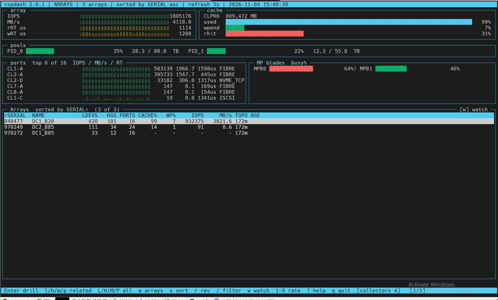
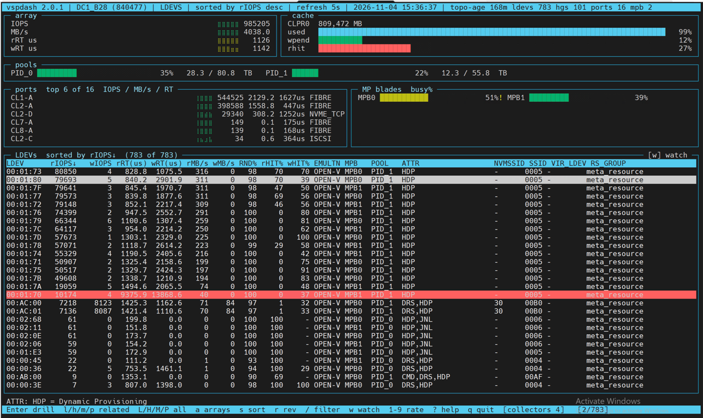
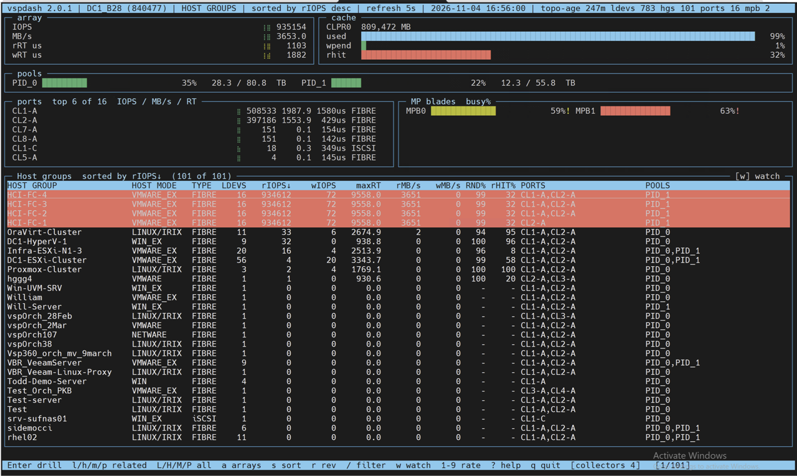
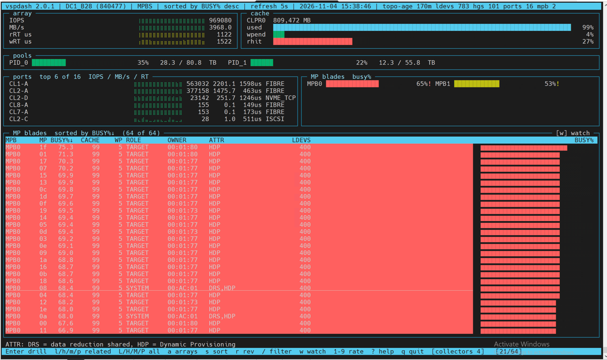
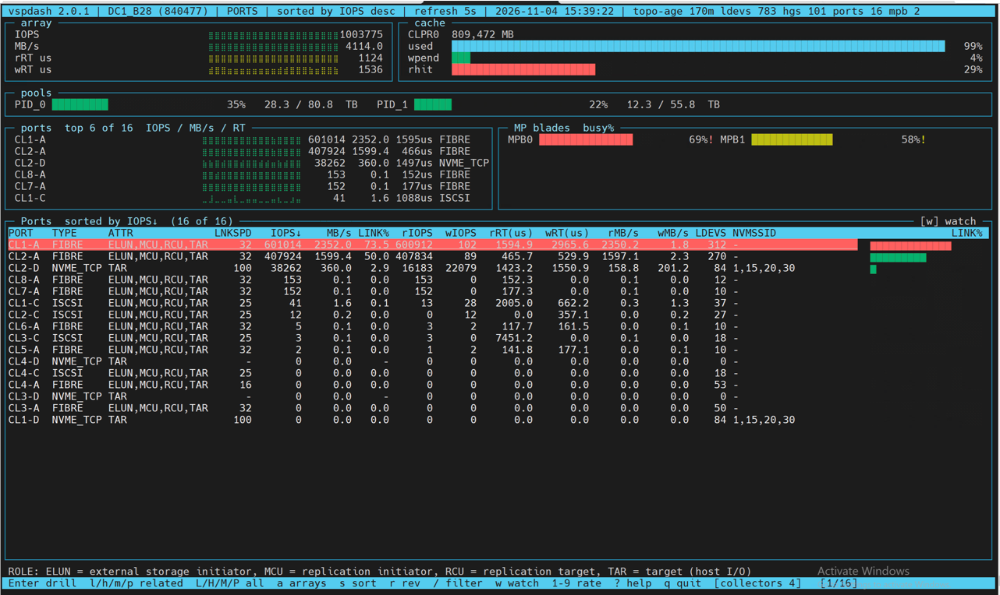

# Screens

All screenshots are `vspdash` 2.0.1 on a VSP One Block 28 (serial 840477) during a synthetic
load test (fio on the HCI-FC host groups, ~1 M IOPS). `vsptop` shows the same tables without
the panels above them. The title line carries the program and version, the array, the screen,
the sort, the refresh interval, the date and time, and the topology summary (age, counts). The
line above the footer spells out the abbreviations in the cursor row's ATTR or ROLE column.

In every view the panels above the table follow the current array: IOPS / MB/s / read and
write response-time history (braille, 64 samples), cache (CLPR size, usage, write-pending,
read-hit %), pool capacity, the six busiest ports with their link type and response time, and
MP-blade busy %. Amber means a warning threshold, red a problem threshold; cache usage is
never coloured because an array runs its cache full by design.

## Arrays

The start screen: one row per array in `vsptop.conf` — LDEV, host-group and port counts
from the topology, cache usage and write-pending %, total IOPS and MB/s from a round-robin
sample, and the age of the topology data. The panels above show the array under the cursor.
`Enter` opens its LDEVs; `l h m p` open LDEVs, host groups, MP blades or ports directly.

## LDEVs

Every LDEV of the array (or those of the host group, port or MP blade you drilled from): read
and write IOPS, response time (µs), MB/s, the random share of I/O (`RND%`), read and write
cache-hit ratios (`rHIT%`, `wHIT%`), emulation, MP blade, pool, volume attributes (`ATTR`),
NVMe subsystem id, mainframe SSID, virtual LDEV id for GAD/VSM volumes, the resource group
and (4.0) the `NAA_ID` hosts see for the volume — `/60060e80…` finds an LDEV from its
host-side identifier. Here the fio volumes run at 80 k IOPS each with sub-millisecond reads; `00:01:70` is
red because its 9.4 / 13.9 ms response times are over the 5 ms problem level while it is busy
(idle volumes are never flagged). Sort with `s`/`S`, filter with `/` (e.g. `/JNL`), and press
`w` to watch the top eight at one-second resolution.

## Host groups

One row per host group: host mode and type (FIBRE for WWN groups, iSCSI for IQN groups),
member count, read/write IOPS, the worst response time among its LDEVs, MB/s, `RND%` and
`rHIT%` weighted by IOPS, the ports it is defined on, the pools its volumes draw from and
(4.0) `WWNS`, the number of initiators registered in the group. The
four HCI-FC groups driving the test are red: their busy LDEVs are above the response-time
problem level. `Enter` lists the group's LDEVs; `p` its ports.

## MP blades

One row per MP (processor core) grouped by blade/MPU: busy %, cache usage and write-pending
% of its CLPR, the role of the resource it is currently serving (TARGET, SYSTEM, …), that
resource's id (`OWNER`) and, when it is an LDEV, the LDEV's attributes, plus the number of
LDEVs assigned to the blade. The right-hand column is a bar of each MP's current busy %. Under
this test every MP of MPB0 is in the 65–75 % band — above the 60 % problem level, hence red —
while the MP blades panel above summarises both MPUs. `Enter` lists the LDEVs assigned to the
blade.

## Ports

One row per installed port: type (FIBRE, ISCSI, NVME_TCP, FICON), attributes (`TAR` target,
`MCU`/`RCU` replication initiator/target, `ELUN` external-storage initiator), link speed in
Gbps, IOPS and MB/s, how much of the link the current MB/s consumes (`LINK%`), read/write
IOPS, read/write response time, read/write MB/s, the number of LDEVs mapped, `nWWN` (since
4.0: how many initiators are logged in right now) and any NVMe subsystem ids. The right-hand column is a bar of `LINK%`. In this capture CL1-A carries
601 k IOPS at 2.35 GB/s — 73 % of its 32G link, over the 60 % problem level, so the row is
red — while CL2-A sits at 50 %. The ports panel above lists the six busiest ports with their
average response time; CL2-D shows NVMe/TCP traffic at 100G. `Enter` lists the port's LDEVs;
`h` its host groups; `i` the initiators logged in to or registered on it.

## Initiators (4.0)

One row per registered initiator per port: the WWN, IQN or host NQN, its type (`FC` /
`ISCSI` / `NVME`), the nickname given to it on the array, `LOGIN` (Y / N for FC WWNs — live,
from the port's login table, re-read every refresh while the screen is up; `-` for IQNs, which
the array reports under internal ids, and for NQNs), the port, the target it is registered in (host group,
iSCSI target or NVMe subsystem) and the number of LDEVs behind that target. Every FC login that
is registered in no host group on its port gets an extra amber row with target `-`, so the
screen doubles as a zoning / registration audit. `Enter` or `l` lists the LDEVs the initiator
can reach (for an NQN, the namespaces of its NVMe subsystem) and `p` the target's ports; the
INITIATOR and TARGET columns widen to their longest value as far as the terminal allows, so a
68-character NQN is shown whole on a wide terminal. Registrations need CCI (`raidcom`); without
it only the logins are shown. A screenshot from the lab array will follow.
